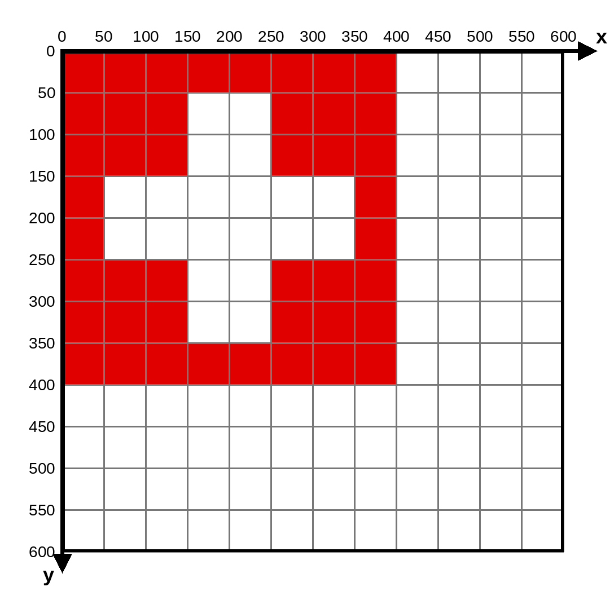
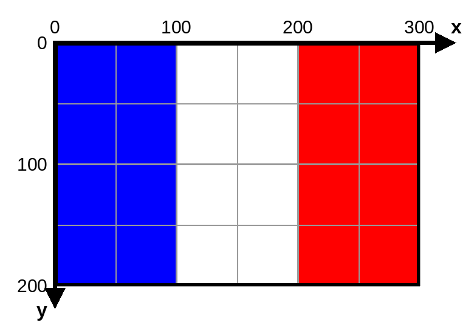
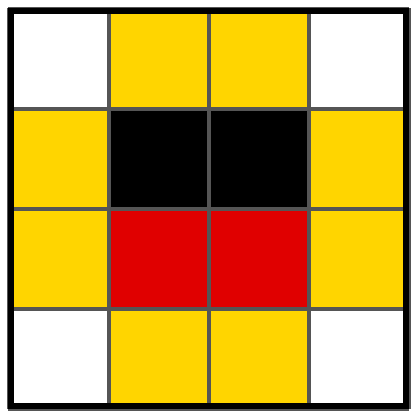
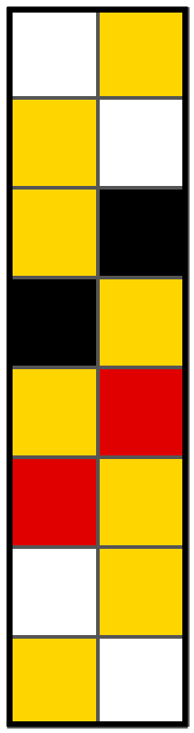
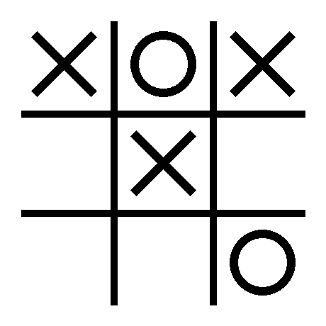
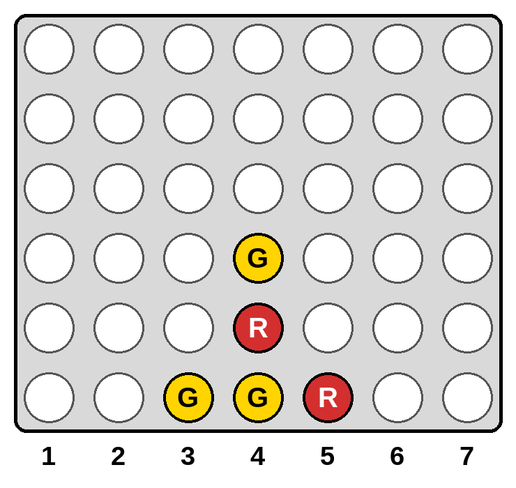

# Lösungen zum Dossier «Dem Fall auf der Spur»

*Dateiformate · Gym · Lesezeit ca. 10 Minuten*

Hier prüfen Sie Ihre Antworten aus dem Dossier. Lösen Sie zuerst die Aufgabe auf Papier und klappen Sie die Lösung erst danach auf. Bei Tandem-Aufgaben gibt es oft mehrere richtige Antworten; die Beispiele zeigen eine mögliche Lösung.

> Dieselben Bits, ein anderes Format, ein anderes Ergebnis: Ein Format ist die «Brille», mit der man Bytes liest (Anordnung und Codierung).

---

## Fall 1 · Die kaputte Nachricht

<details><summary>1.1 Was wollte Mia schreiben?</summary>

**Ich bin in Zürich angekommen! 😀**

Das Handy hat Bytes in einer anderen Codierung gelesen, als sie geschrieben wurden: UTF-8-Text wurde mit einer alten Ein-Byte-Codierung (Windows-1252) gelesen. Die Bytes sind in Ordnung, nur die Brille ist falsch.

</details>

<details><summary>1.2 Mias Nachricht mit Brille B ergänzen</summary>

| Byte | 5A | C3 | BC | 72 | 69 | 63 | 68 |
|---|---|---|---|---|---|---|---|
| Zeichen (Brille B) | Z | Ã | ¼ | r | i | c | h |

Das ergibt **Zürich**. Die Tabelle, mit der Sie `5A` = Z, `72` = r und `69` = i gelesen haben, heisst **ASCII**. Sie umfasst nur die Codes `00` bis `7F`. à und ¼ stammen aus dem erweiterten Teil der alten Windows-Codierung (`80` bis `FF`).

</details>

<details><summary>1.3 Tandem Challenge: ein Wort teilweise in Hex</summary>

Individuell. Ihr Gegenüber prüft mit der ASCII-Tabelle. Typische Fehler: Gross- und Kleinschreibung verwechselt (`48` ist H, `68` ist h) oder ein Byte ausgelassen. Beispiel: H `61` l l `6F` ergibt **Hallo**.

</details>

---

## Fall 2 · Die Rätsel-Datei

<details><summary>2.1 Die ersten 8 Bytes übersetzen</summary>

`3C` = `<`, `73` = s, `76` = v, `67` = g, `20` = Leerzeichen, `76` = v, `65` = e, `72` = r. Gelesen ergibt es: `<svg version="1.`

</details>

<details><summary>2.2 Was verrät der Anfang der Datei?</summary>

Die Datei beginnt mit lesbarem Text, `<svg`. Es ist ein **SVG**: ein Bild, das als Text beschrieben wird (Textformat). Man kann es mit einem Text-Editor lesen.

</details>

<details><summary>2.3 Das Bild zeichnen</summary>

Es ist die **Schweizer Flagge**: roter Hintergrund von 0 bis 400 mit weissem Kreuz. Der übrige Bereich bis 600 bleibt leer.

- Waagrechter Balken: x von 50 bis 350, y von 150 bis 250.
- Senkrechter Balken: x von 150 bis 250, y von 50 bis 350.

Denken Sie daran: Die y-Achse zeigt nach unten.



</details>

<details><summary>2.4 Was ändert sich bei fill="#0000FF"?</summary>

Der Hintergrund wird **blau**, das Kreuz bleibt weiss. Herleitung: `#0000FF` bedeutet Rot `00`, Grün `00`, Blau `FF`.

</details>

<details><summary>2.5 Tandem Check: Zeichnung vergleichen</summary>

Wer anders gezeichnet hat, rechnet die Koordinaten nach (1 Kästchen = 50 Einheiten).

</details>

<details><summary>2.6 Tandem Challenge: Flagge raten</summary>

Farbtabelle: Rot `#FF0000`, Grün `#00AA00` (auch `#00FF00` oder ähnlich ist in Ordnung), Schwarz `#000000`, Weiss `#FFFFFF`.

Die Flagge ist individuell. Beispiel **Frankreich** (drei senkrechte Streifen, Breite je 100):

```
<rect fill="#0000FF" x="0" y="0" width="100" height="200"/>
<rect fill="#FFFFFF" x="100" y="0" width="100" height="200"/>
<rect fill="#FF0000" x="200" y="0" width="100" height="200"/>
```

Bei zwei waagrechten Streifen (zum Beispiel Polen: Weiss oben, Rot unten) gilt `y="0"` und `y="100"`, `width="300"`, `height="100"`. Typische Fehler: x-Werte vergessen oder Breite 300 statt 100.



</details>

<details><summary>2.7 ★ Was passiert, wenn die y-Werte geändert werden?</summary>

Der waagrechte Balken wird dünner: Er geht nur noch von y = 200 bis 250 (50 hoch statt 100). Das Kreuz ist nicht mehr symmetrisch.

</details>

---

## Fall 3 · Die Bild-Datei

Die Datei hat 64 Bit: 16 Bit Header und 48 Bit Pixeldaten.

<details><summary>3.1 Daten nach Format A aufteilen</summary>

| Feld | Bits | Dezimal |
|---|---|---|
| Breite (4 Bit) | `0100` | 4 |
| Höhe (4 Bit) | `0100` | 4 |
| Farbtiefe (8 Bit) | `00000011` | 3 |

Pixeldaten (nach Zeilen getrennt): `111110110111` `110000000110` `110100100110` `111110110111`

</details>

<details><summary>3.2 Fragen zu Format A</summary>

- **a)** Farbtiefe: **3 Bit** pro Pixel.
- **b)** 2³ = **8 Farben**.
- **c)** n = 4 · 4 · 3 = **48 Bit**. Kontrolle: Nach dem Header bleiben genau 48 Bit.
- **d)** Header 16 Bit plus 48 Bit Pixeldaten = **64 Bit** (8 Byte).

</details>

<details><summary>3.3 Das Bild nach Format A zeichnen</summary>

4 Pixel pro Zeile, 4 Zeilen, je Pixel 3 Bit für Rot, Grün und Blau (1 = an, 0 = aus):

| Zeile | Pixel |
|---|---|
| 1 | weiss, gelb, gelb, weiss |
| 2 | gelb, schwarz, schwarz, gelb |
| 3 | gelb, rot, rot, gelb |
| 4 | weiss, gelb, gelb, weiss |

Herleitung: `111` = alles an = weiss, `110` = Rot und Grün = gelb, `000` = alles aus = schwarz, `100` = nur Rot = rot. Das Bild ist ein **Smiley**.



</details>

<details><summary>3.4 Dieselben Daten nach Format B</summary>

Format B teilt den Header als 3 | 6 | 7 Bit auf: `010` | `001000` | `0000011`. Das ergibt **Breite 2, Höhe 8, Farbtiefe 3**. Kontrolle: n = 2 · 8 · 3 = 48 Bit, die Pixeldaten sind dieselben 48 Bit.

Eine Zeile hat jetzt 2 Pixel (6 Bit): weiss gelb · gelb weiss · gelb schwarz · schwarz gelb · gelb rot · rot gelb · weiss gelb · gelb weiss.

Es entsteht ein **anderes Bild** (ein schmaler Streifen, kein Smiley). Dieselben Bits ergeben mit einem anderen Format, also einer anderen Brille, ein anderes Ergebnis.



</details>

<details><summary>3.5 ★ Wie gross ist das Foto?</summary>

4000 · 3000 · 24 Bit = 288 000 000 Bit = 36 000 000 Byte. Dazu kommen 12 Byte Header: **36 000 012 Byte, rund 36 MB**.

Der Header fällt praktisch nicht ins Gewicht (12 Byte von 36 Millionen, etwa 0,00003 %). Bei sehr kleinen Bildern wie in 3.1 (2 von 8 Byte) ist sein Anteil dagegen gross.

</details>

---

## Fall 4 · Die falsche Endung

Jedes Format beginnt mit einer festen Bytefolge, der **Magic Number**.

<details><summary>4.1 Passt die Endung zum Header?</summary>

| Datei | passt? | Wirklich ein … |
|---|---|---|
| Ferienfoto.jpg | nein | Windows-Programm (`4D 5A` = «MZ»). Gefährlich! |
| Bewerbung.docx | ja | ZIP-Container (`50 4B` = «PK»). Alle Office-Dateien sind ZIP. |
| Katze.png | nein | JPG-Bild (`FF D8 FF E0`, daneben «JF»), kein PNG. |
| Rechnung.pdf | ja | PDF (`25 50 44 46` = «%PDF») |
| Lustig.gif | ja | GIF (`47 49 46 38 39 61` = «GIF89a») |

Hinweis zur Textspalte im Spickzettel: `FF D8 FF` erscheint dort als ÿØÿ und `89` als ‰. Diese Zeichen gehören zur erweiterten Tabelle (Windows-1252, ähnlich Latin-1); in 7-Bit-ASCII (`00` bis `7F`) wären sie nicht lesbar.

</details>

<details><summary>4.2 Welche Datei nie öffnen?</summary>

«Ferienfoto.jpg» nie öffnen: Es ist ein Programm. Die Endung kann jeder umbenennen, und viele Systeme blenden sie aus. Wichtig ist der Header, der sich nicht so leicht fälschen lässt.

</details>

---

## Fall 5 · Der Spielstand

<details><summary>5.1 Tic-Tac-Toe: Bitfolge entschlüsseln</summary>

`0111011001100000010` = `0` | `11 10 11` | `00 11 00` | `00 00 10`

Kreis ist am Zug (erstes Bit 0). Es sind 3 Kreuze und 2 Kreise gesetzt: Das passt, Kreis ist dran.



</details>

<details><summary>5.2 Spielfeld als Bitfolge schreiben</summary>

`1` | `11 10 11` | `10 11 00` | `10 00 00` = `1111011101100100000` (19 Bit)

Kreuz ist am Zug (erstes Bit 1), weil beide gleich viele Zeichen gesetzt haben (je 3) und Kreuz begonnen hat.

</details>

<details><summary>5.3 Tandem Check</summary>

Typische Fehler: Zugbit vergessen, Felder in falscher Reihenfolge, leeres Feld nicht als `00` geschrieben.

</details>

<details><summary>5.4 4 gewinnt: Spielstand zeichnen</summary>

`100000000100110100011000000` = `1` | `000` | `000` | `001` `0` | `011` `010` | `001` `1` | `000` | `000`

Rot ist am Zug (erstes Bit 1). Spalte 3 hat 1 gelben Stein. Spalte 4 hat von unten gelb, rot, gelb. Spalte 5 hat 1 roten Stein. Alle anderen Spalten sind leer. Die Steine einer Spalte stehen von unten nach oben.

Ein Spielstand mit 12 Steinen braucht 1 + 7 · 3 + 12 = **34 Bit**.



</details>

<details><summary>5.5 ★ Ein Format für ein ganzes Spiel erfinden</summary>

Individuell, es gibt mehrere richtige Lösungen. Ein gutes Format ist (1) eindeutig, (2) vollständig, (3) die Bitanzahl ist korrekt berechnet und (4) das Beispiel lässt sich zurückübersetzen. Je sparsamer, desto besser, wichtiger ist aber die Verständlichkeit.

Mögliche Musterlösungen (nicht die einzig richtigen):

| Spiel | Format und Bitanzahl |
|---|---|
| A: Eile mit Weile | Pro Figur (16): im Start, Feld 1 bis 40 oder Zielfeld 1 bis 4 = 45 Möglichkeiten, also 6 Bit. 16 · 6 = 96 Bit, dazu 2 Bit für den Spieler am Zug (4 Spieler): **98 Bit**. |
| B: Schiffe versenken | Pro Feld 2 Bit (Wasser, Wasser beschossen, Schiff, Schiff getroffen). 100 Felder = 200 Bit je Spieler, bei zwei Spielern 400 Bit, dazu 1 Bit für den Zug: **401 Bit**. |
| C: Bauernschach | Pro Feld 2 Bit (leer, weiss, schwarz). 64 · 2 = 128 Bit, dazu 1 Bit für den Zug: **129 Bit**. Sparsamer: pro Bauer (16) 6 Bit Feldnummer und 1 Bit «noch im Spiel». |
| D: Nünistei | Pro Punkt 2 Bit (leer, rot, blau). 24 · 2 = 48 Bit. Dazu 1 Bit für den Zug und je Spieler 4 Bit für die Zahl der noch nicht gesetzten Steine (0 bis 9): **57 Bit**. |

</details>

<details><summary>5.6 ★ Tausch im Tandem</summary>

Die Rückmeldung Ihres Gegenübers zeigt, ob Ihr Format ohne Zusatzerklärung verständlich ist. Das ist der wichtigste Lerneffekt: Ein Format muss für jemand anderen lesbar sein.

</details>

<details><summary>5.7 ★ Wie viele Bits für ein volles Brett bei 4 gewinnt?</summary>

Brett voll: 7 · 6 = 42 Steine. 1 + 7 · 3 + 42 = **64 Bit**.

</details>

<details><summary>5.8 ★ Tic-Tac-Toe noch sparsamer</summary>

3⁹ = 19 683 Bretter. 2¹⁴ = 16 384 sind zu wenig, 2¹⁵ = 32 768 reichen: **15 Bit**.

Das Zugbit ist überflüssig, weil sich aus der Anzahl Kreuze und Kreise ableiten lässt, wer dran ist (gleich viele: Kreuz, sonst Kreis).

</details>

---

## Abschluss

<details><summary>A.1 Merksätze</summary>

1. Ein **Format** legt fest, wie die Bits einer Datei angeordnet sind und was sie bedeuten.
2. Der Computer erkennt das Format an der **Endung** und am **Header**.
3. Alle Daten sind im Computer **binär** gespeichert.

</details>

<details><summary>A.2 Welche Hinweise gibt es auf den Dateityp?</summary>

Der Computer nutzt zwei Hinweise: die **Endung** und den **Header** (die ersten Bytes, die Magic Number, zum Beispiel `%PDF`, `PK`, `BM`). Als dritten Hinweis haben Menschen im Hex-Editor den **lesbaren Text** im Inhalt (zum Beispiel `<svg` in Fall 2). Zusätzlich möglich: Dateigrösse und Aufbau.

</details>

---

Prüfen Sie Ihr Wissen mit dem [Dateiformat-Check](../../../dateiformate/format-check/).
